# Manual del administrador

El administrador configura el local, la carta, los usuarios y los equipos, y aprueba anulaciones. Trabaja desde una computadora o su celular.

## 1. Ingresar

1. Abra la aplicación en `/admin/ingresar`.
2. Escriba su **email** y **contraseña** y toque **Continuar**.

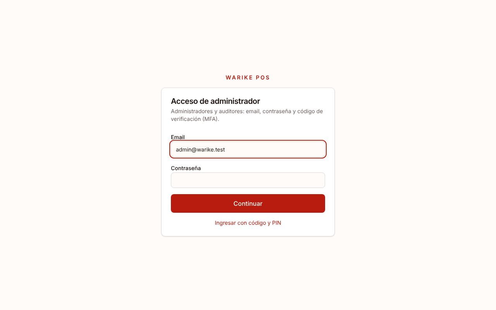

3. **Verificación en dos pasos (MFA)**: la primera vez, escanee el código QR con Google Authenticator (u otra app de códigos) y escriba el código de 6 dígitos. Las siguientes veces solo escribe el código de la app.

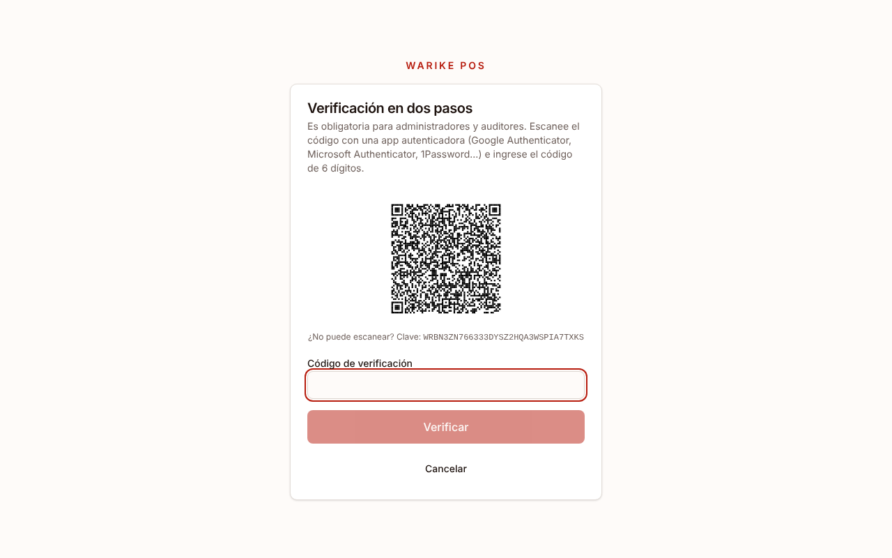

> En el proyecto de pruebas este paso está desactivado. En producción siempre se pide.

Al entrar verá todos sus módulos.

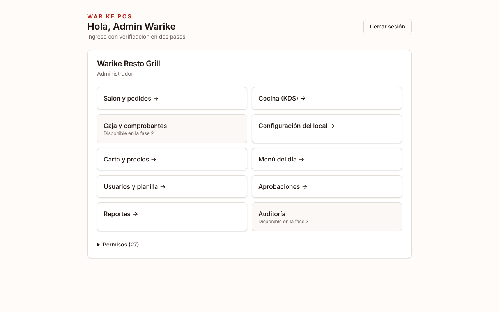

## 2. Resumen

**Administración → Resumen** muestra las aprobaciones pendientes, las mesas en curso con lo que falta cobrar, y el estado de las impresoras (por ejemplo, si el agente de impresión está sin conexión).

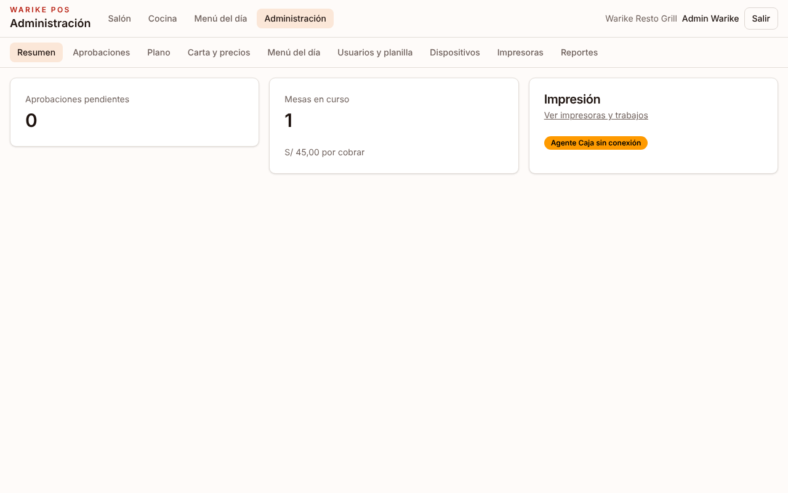

## 3. Carta y precios

Lista de productos con su categoría, precio y estado. Desde aquí puede:

- **Nuevo producto** / **Editar**: nombre, código, categoría, estación, opciones (modificadores).
- **Agotar** / **Habilitar** un plato.
- **Precio**: cambia el precio de un plato. Pide un **motivo** y queda en el **Historial**. Las mesas abiertas conservan el precio con el que se pidió.
- **Cambio masivo de precios**: sube o baja un porcentaje a toda la carta o a una categoría.
- Pestañas **Categorías**, **Modificadores** y **Estaciones**.

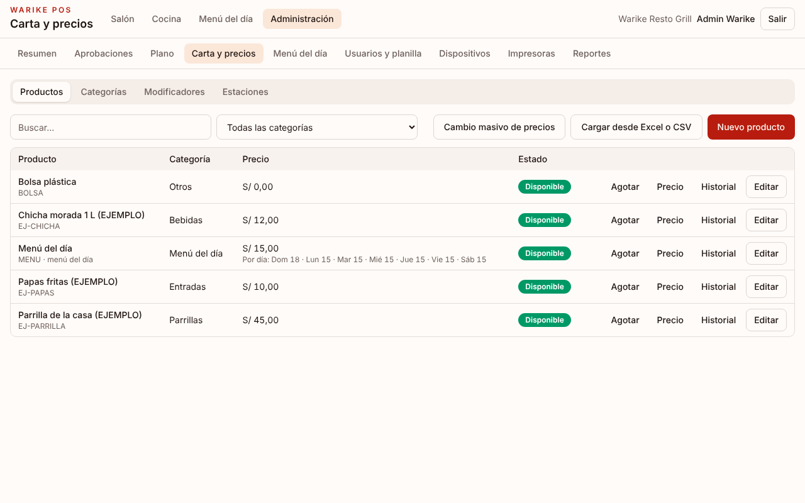

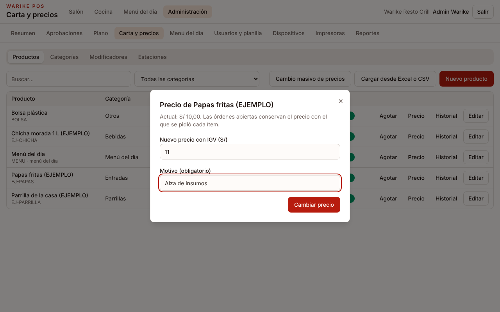

### Cargar la carta desde Excel o Google Sheets

1. Toque **Cargar desde Excel o CSV**.
2. Descargue la **Plantilla Excel**, la **Plantilla CSV**, o la **Carta actual** para editar la que ya tiene.
3. Llénela. Columnas:

   | Columna       | Obligatoria      | Ejemplo                  |
   | ------------- | ---------------- | ------------------------ |
   | `codigo`      | No (recomendado) | LOMO                     |
   | `nombre`      | Sí               | Lomo saltado             |
   | `categoria`   | Sí               | Fondos                   |
   | `precio`      | Sí, con IGV      | 32 o 32,50               |
   | `descripcion` | No               | Con papas fritas y arroz |
   | `estacion`    | No               | Cocina, Parrilla o Bar   |
   | `disponible`  | No               | si / no                  |

4. Desde Google Sheets: **Archivo → Descargar → Microsoft Excel (.xlsx)** o **CSV**.
5. Suba el archivo. Verá una **vista previa** (productos nuevos, actualizados, categorías nuevas) sin que nada se guarde todavía. Si hay errores, se listan con su número de fila.
6. Si el archivo cambia precios, escriba el **motivo**. Toque **Aplicar**.

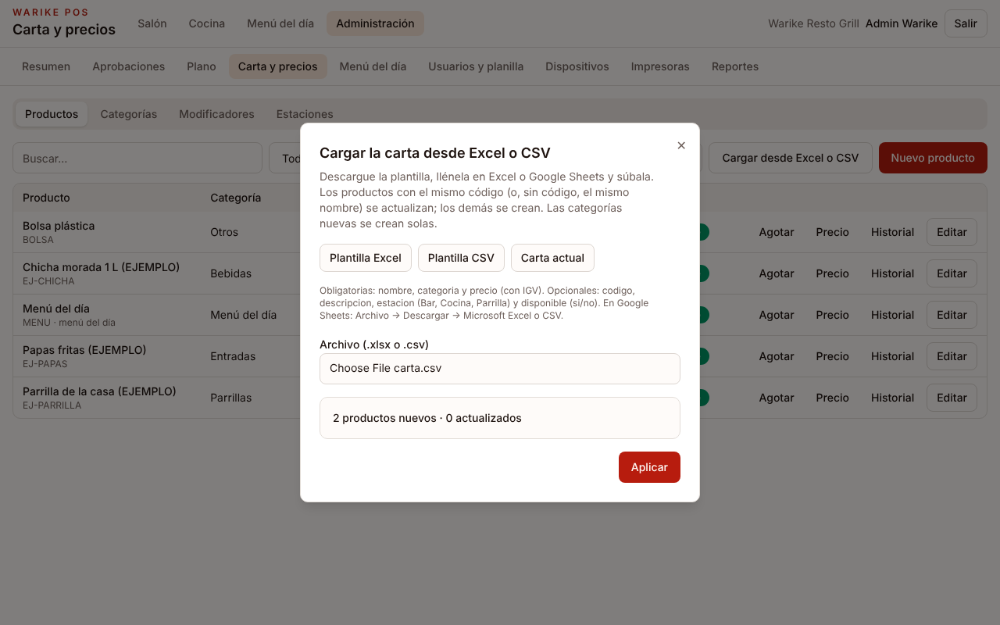

Reglas: un producto se reconoce por su código (o, si no tiene, por su nombre); las categorías que no existen se crean; una celda vacía no borra lo que ya había; se guarda todo el archivo o nada.

## 4. Menú del día

Elija la **fecha**, escriba las **entradas** y los **segundos** (uno por línea) y toque **Publicar**. Desde ese momento los mozos pueden pedir el menú eligiendo entrada y segundo. El precio por día (lunes a sábado S/ 15, domingo y feriados S/ 18) se configura en el producto "Menú del día".

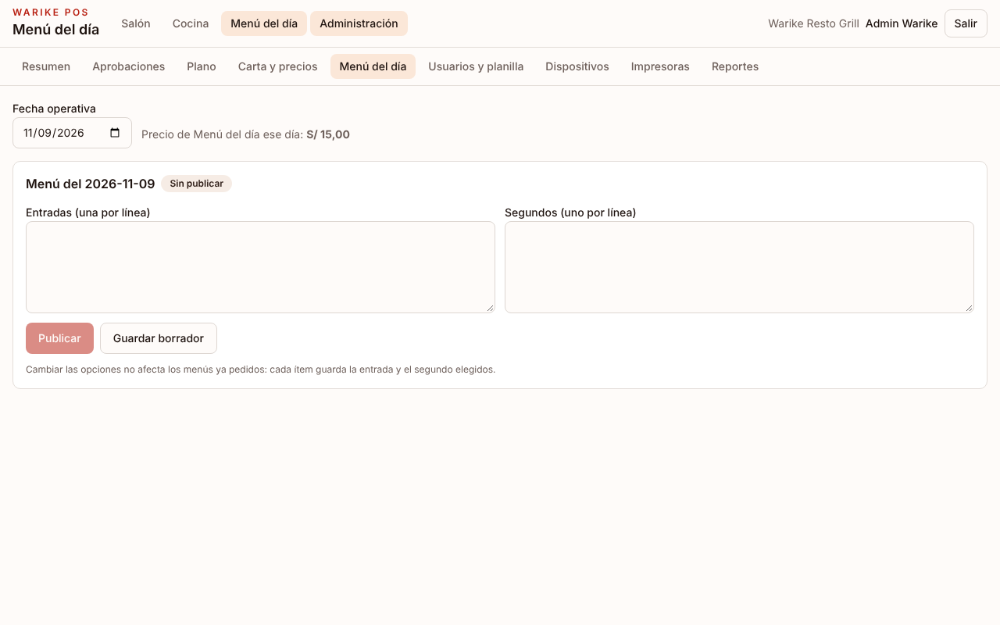

## 5. Usuarios y planilla

Lista del personal con su código, rol y estado. Acciones por usuario: **PIN** (cambiar o desbloquear), **Roles**, **Desactivar**.

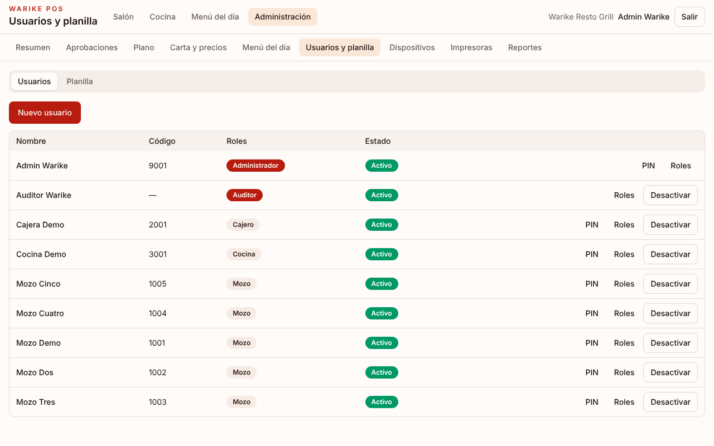

**Nuevo usuario**:

- **Mozo, cajero o cocina**: nombre, **código de empleado** y **PIN** de 4 a 6 dígitos (no use PIN obvios como 1234).
- **Administrador o auditor**: email y contraseña inicial; en su primer ingreso configura la verificación en dos pasos.

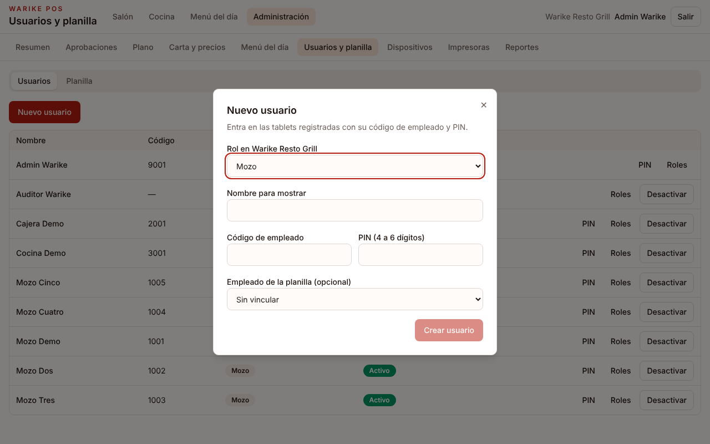

La pestaña **Planilla** guarda los datos de los empleados.

## 6. Aprobaciones (desde el celular)

Cuando un mozo pide anular un plato con **Pedir aprobación al admin**, la solicitud aparece en vivo en **Aprobaciones**, con la mesa, el plato, el motivo y quién la pide. Toque **Aprobar** o **Rechazar**; la tablet del mozo se actualiza al instante.

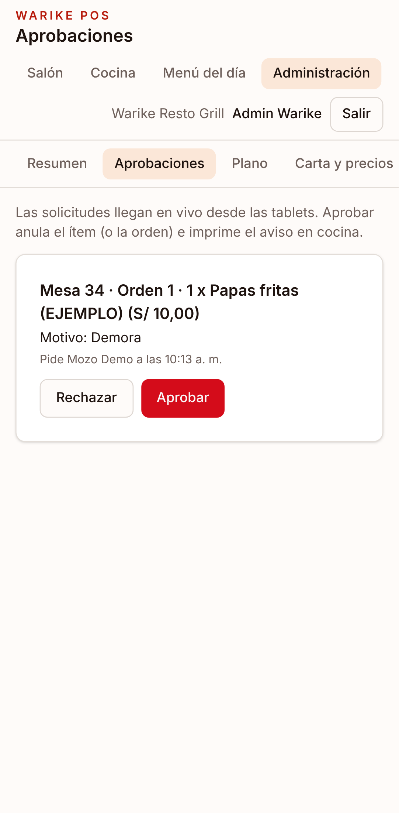

## 7. Plano del salón

Editor del plano por piso: arrastre las mesas para ubicarlas, cambie su forma, tamaño, capacidad o nombre, y agregue pisos o mesas nuevas.

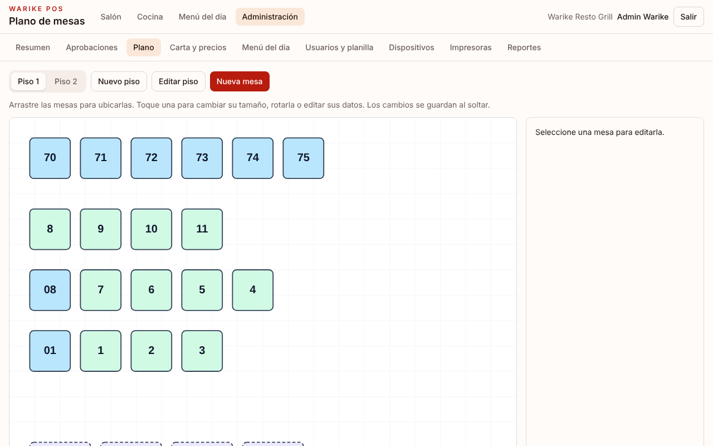

## 8. Dispositivos

Lista de tablets, pantallas de cocina, cajas y agentes de impresión, con su última conexión.

- **Registrar dispositivo**: en el equipo nuevo (tablet o pantalla), abra la aplicación, toque **Ingresar como administrador**, entre con su cuenta y registre el equipo con un nombre y su tipo. El equipo queda listo para que el personal entre con código y PIN, y su sesión de administrador se cierra.
- **Revocar**: si un equipo se pierde o se reemplaza, revóquelo. Sus sesiones se cierran al instante.

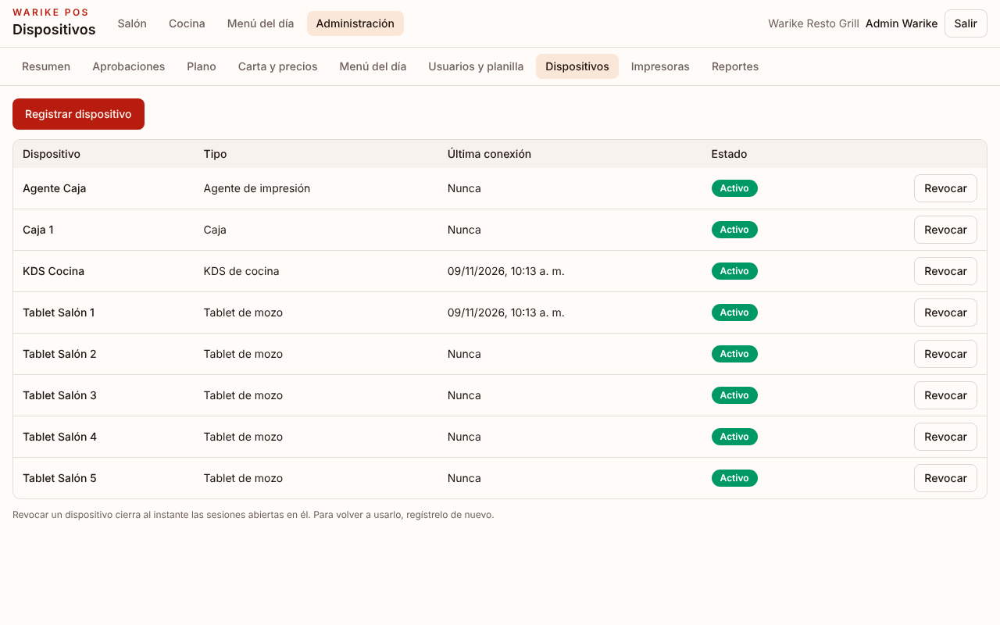

## 9. Impresoras

Registre cada impresora térmica (red o USB, papel de 58 u 80 mm) y el agente que la atiende. Abajo verá la cola de trabajos: **Pendientes y con error**, con la opción **Redirigir trabajo** a otra impresora si una falla.

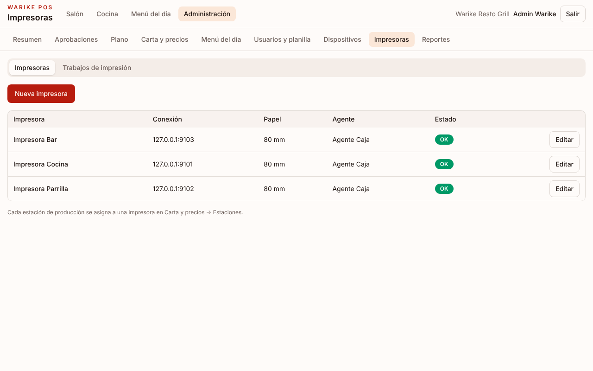

## 10. Reportes

Elija **Desde** y **Hasta** para ver las ventas por mozo y las anulaciones (con motivo, quién autorizó y si hubo merma). Puede descargarlos en CSV.

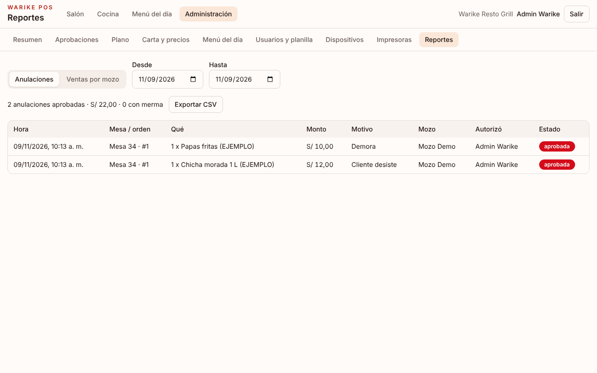
