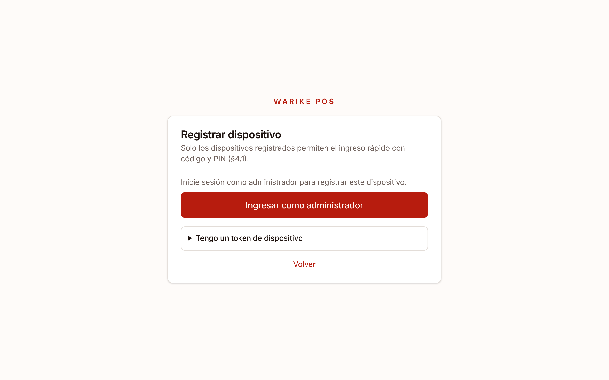
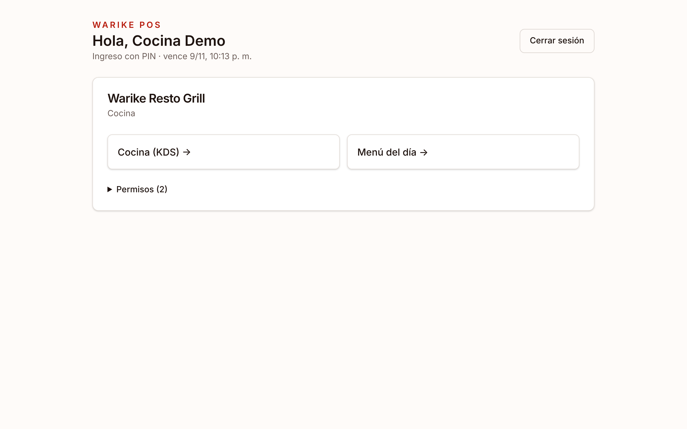
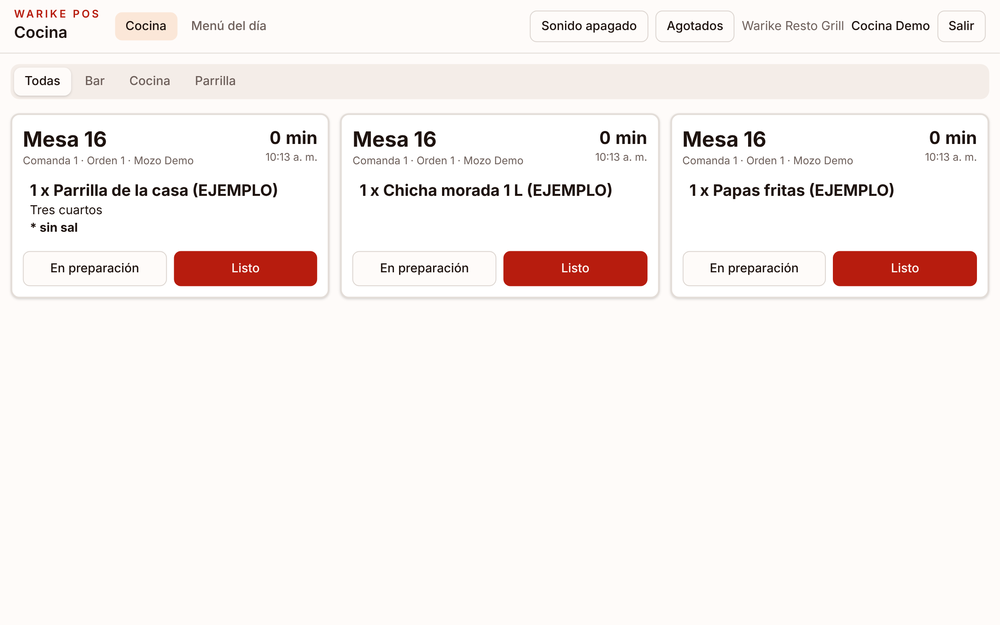
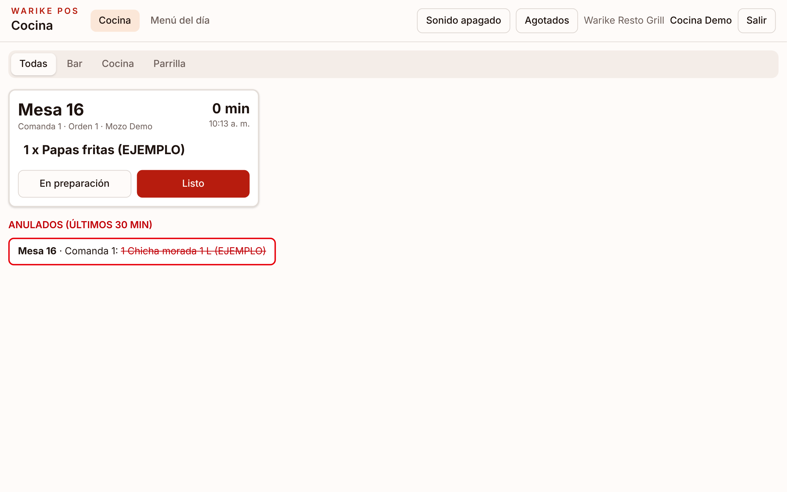
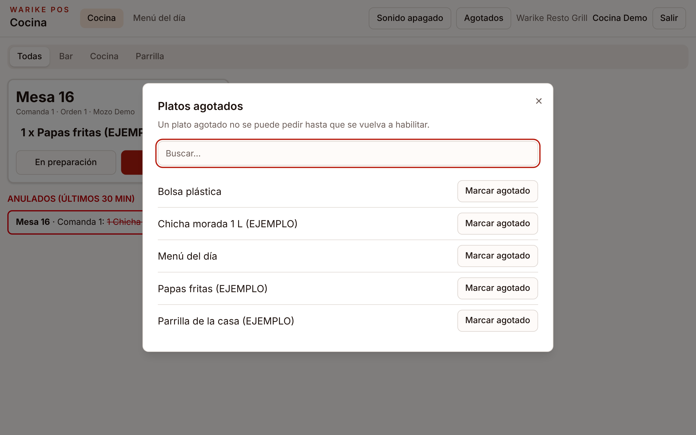

# Manual de cocina

Cocina trabaja en la **pantalla de comandas (KDS)**: una tablet o pantalla registrada en la cocina, la parrilla o el bar.

## 1. Ingresar

La pantalla debe estar registrada por el administrador (igual que las tablets de los mozos). Luego cada cocinero entra con su **código de empleado** y su **PIN**.

Al entrar, toque **Cocina (KDS)**.

## 2. Las comandas

Cada tarjeta es una comanda de una mesa: muestra la mesa, el mozo, los platos con sus opciones y notas (las notas van con `*`), y los minutos que lleva esperando.

- Use las pestañas (**Bar**, **Cocina**, **Parrilla**) para ver solo su estación, o **Todas**.
- El tiempo cambia de color: **amarillo** a los 15 minutos y **rojo** a los 25. Estos tiempos se pueden cambiar en la configuración del local (por ahora, a pedido a soporte).
- **Sonido apagado / activado**: toque el botón al empezar el turno para oír un aviso con cada comanda nueva.

## 3. Avanzar los platos

- **En preparación**: indica que ya empezó a prepararlo.
- **Listo**: el plato sale del KDS y al mozo le llega el aviso para servirlo.

## 4. Platos anulados

Si un mozo anula un plato ya enviado, aparece tachado en **Anulados (últimos 30 min)**, y la impresora de la estación imprime el aviso. No lo prepare.

## 5. Platos agotados

Cuando se acaba un plato, toque **Agotados**, búsquelo y toque **Marcar agotado**. Las tablets de los mozos dejan de ofrecerlo al instante. Cuando vuelva a haber, toque **Habilitar** en la misma ventana.

## 6. Salir

Al terminar el turno toque **Salir**.
