# Manual del mozo

El mozo trabaja en una **tablet registrada** del local. Entra con su **código de empleado** y su **PIN**; la sesión dura el turno (12 h) y solo funciona en esa tablet.

## 1. Primera vez: la tablet debe estar registrada

Esto lo hace el administrador una sola vez por tablet. Si al abrir la aplicación aparece esta pantalla, avise al administrador: debe tocar **Ingresar como administrador**, entrar con su cuenta y registrar la tablet con un nombre (por ejemplo, "Tablet Salón 1").

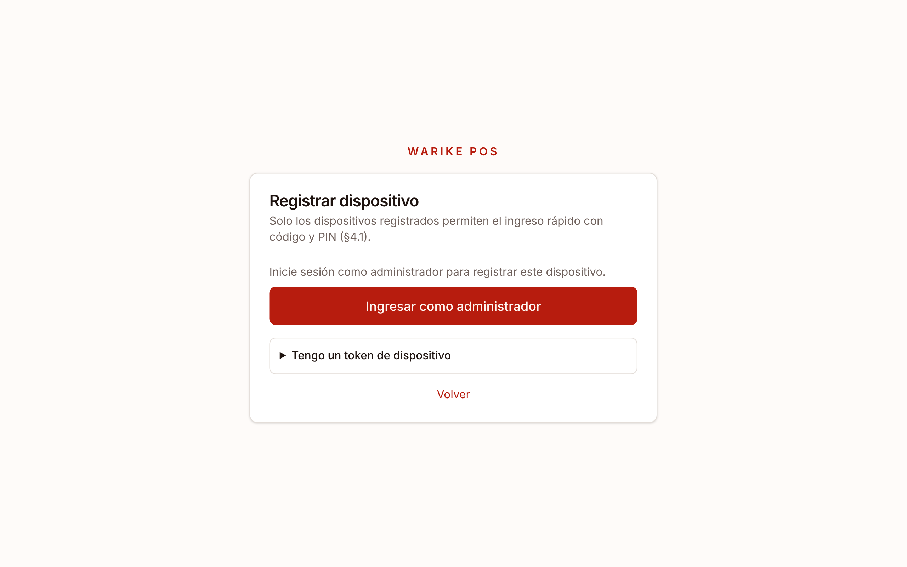

## 2. Ingresar con código y PIN

1. Escriba su **código de empleado**.
2. Toque el campo **PIN** y marque sus dígitos en el teclado numérico.
3. Toque **Ingresar**.

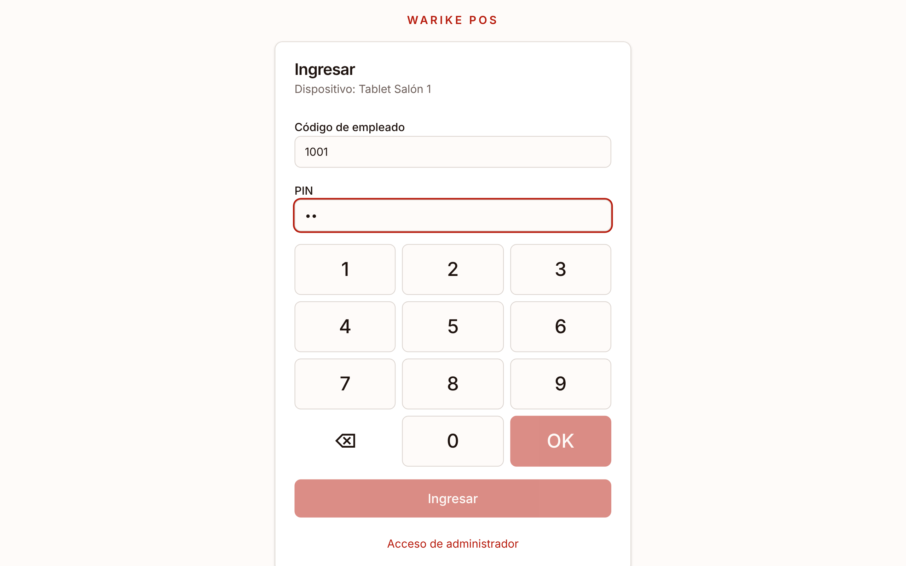

Si se equivoca 5 veces seguidas, su usuario se bloquea 15 minutos; el administrador puede desbloquearlo.

Al entrar verá sus módulos. Toque **Salón y pedidos**.

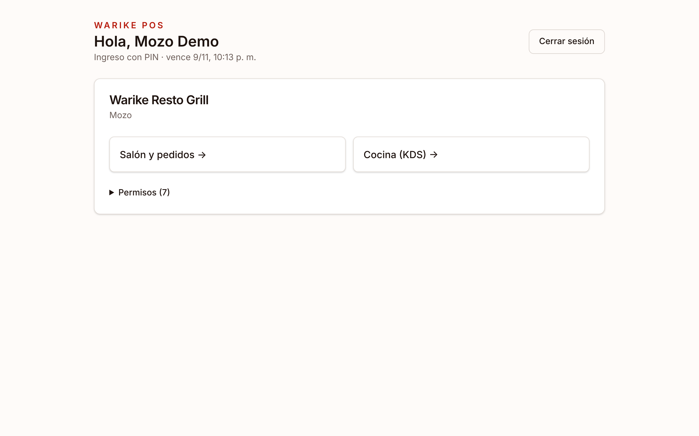

## 3. El salón

El plano muestra las mesas de cada piso (pestañas **Piso 1**, **Piso 2**) con su estado en vivo:

| Color    | Estado      |
| -------- | ----------- |
| Verde    | Libre       |
| Rojo     | Ocupada     |
| Amarillo | Pre-cuenta  |
| Gris     | Por limpiar |
| Negro    | Bloqueada   |

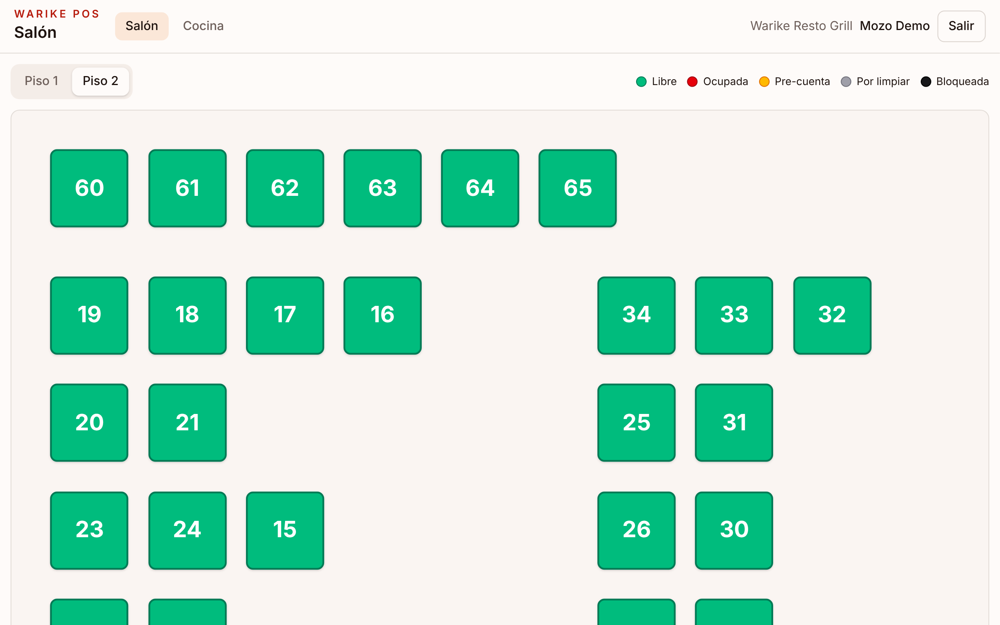

Lo que hace otro mozo aparece en su tablet en uno o dos segundos.

## 4. Abrir una mesa

1. Toque una mesa libre.
2. Elija el número de **comensales**.
3. Toque **Abrir mesa**.

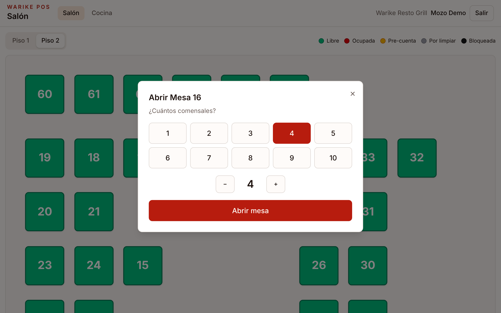

Se abre la orden: a la izquierda la carta, a la derecha la cuenta.

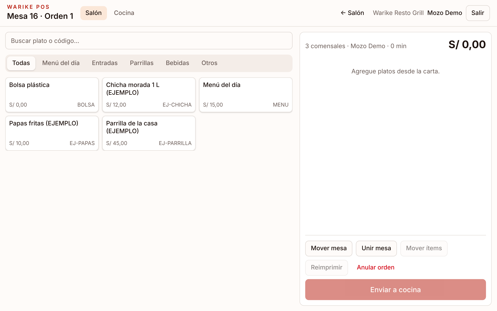

## 5. Tomar el pedido

- Toque un plato para agregarlo. Puede buscar por nombre o código, o filtrar por categoría.
- Si el plato tiene opciones (por ejemplo, el **término** de la carne), se abre una ventana: elija las obligatorias y, si hace falta, escriba una **nota para cocina** ("sin sal"). Luego toque **Agregar**.

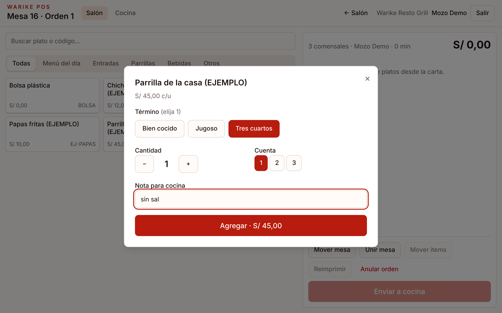

Los platos recién agregados quedan en **borrador**: todavía no llegan a cocina y puede cambiarlos o quitarlos sin autorización.

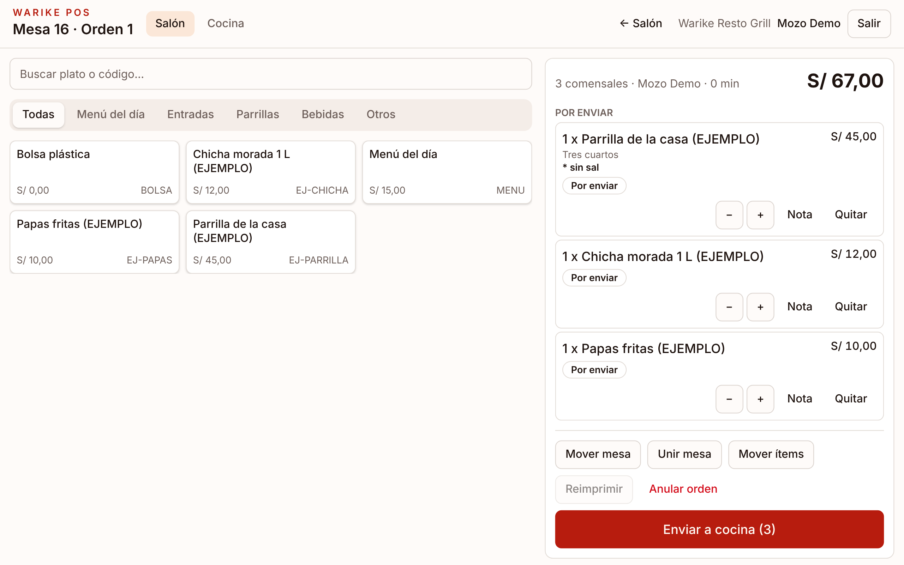

## 6. Enviar a cocina

Toque **Enviar a cocina**. Cada estación (cocina, parrilla, bar) recibe su comanda en pantalla y en su impresora. Los ítems pasan a **Enviado**.

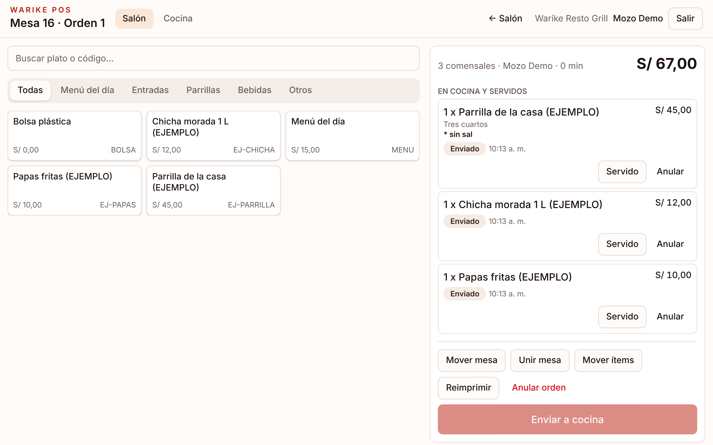

Si una comanda no salió impresa, use **Reimprimir**.

## 7. Platos listos y servidos

Cuando cocina marca un plato como listo, le aparece arriba el aviso **Listos para servir** (con sonido), en cualquier pantalla. Al llevarlo a la mesa, toque **Servido**.

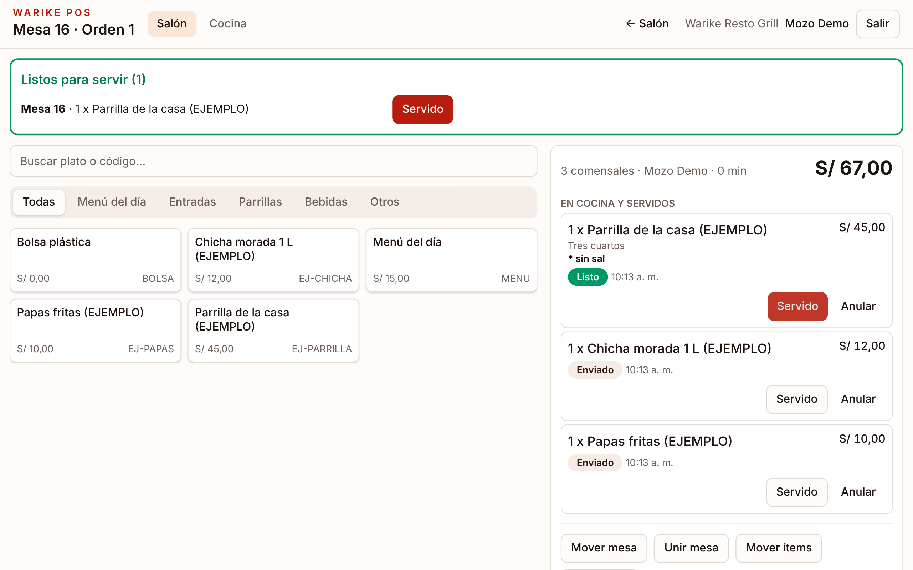

## 8. Anular un plato ya enviado

Un plato en borrador se quita sin más. Uno ya enviado necesita **motivo** y **autorización**:

1. Toque **Anular** en el plato.
2. Elija el **motivo**; si el plato ya se preparó, marque **Hubo merma**.
3. Pida autorización de una de dos formas:
   - **Autorizar y anular**: el supervisor escribe su código y PIN en su tablet.
   - **Pedir aprobación al admin**: la solicitud llega al celular del administrador.

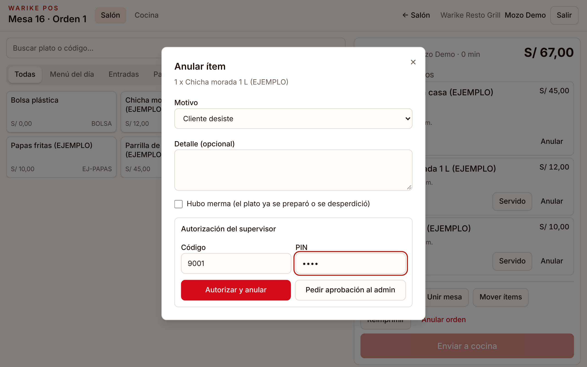

El plato queda **Anulado**, el total se corrige y cocina recibe el aviso impreso.

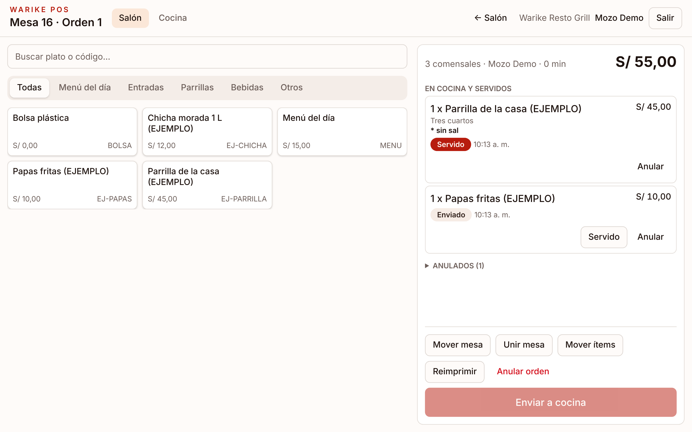

Mientras el administrador decide, el plato muestra **Anulación pendiente**.

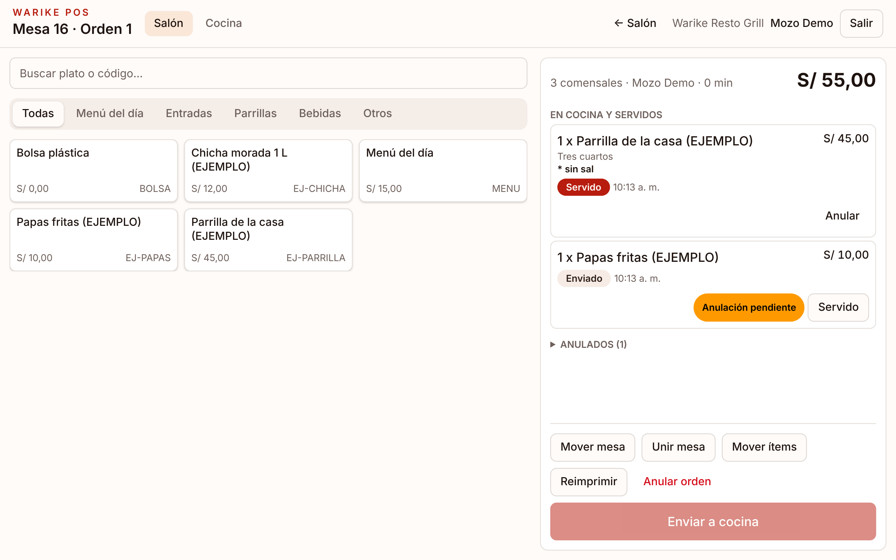

Para cancelar toda la mesa use **Anular orden**. Si nada llegó a cocina, no necesita autorización.

## 9. Mover, unir y dividir mesas

En la orden:

- **Mover mesa**: pasa la cuenta completa a otra mesa libre, de cualquier piso. La mesa anterior queda **por limpiar**.
- **Unir mesa**: junta esta cuenta con la de otra mesa.
- **Mover ítems**: lleva algunos platos a otra mesa.

Elija el piso, toque la mesa de destino y **Confirmar**. Cocina recibe el aviso del cambio.

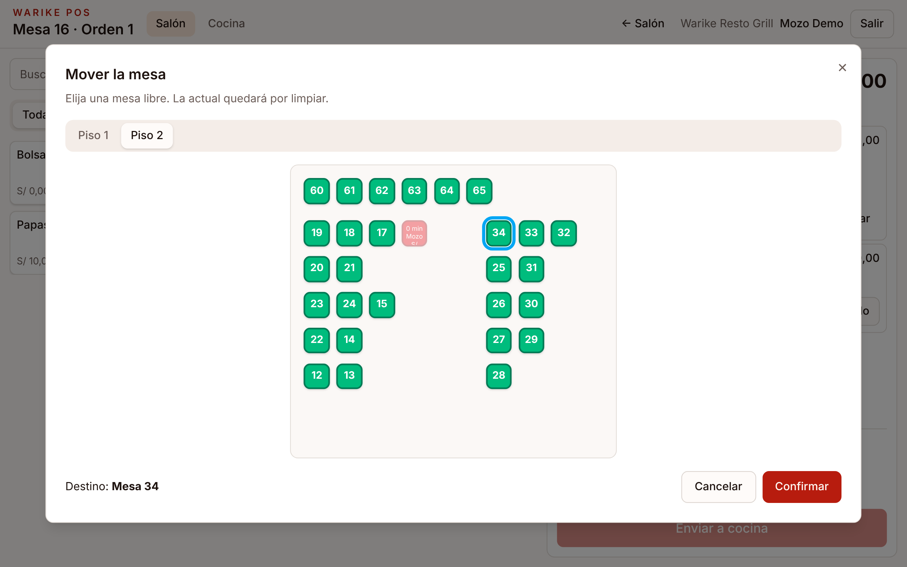

## 10. Salir

Al terminar el turno toque **Salir** (arriba a la derecha). Nunca deje la tablet con su sesión abierta para otro compañero.
